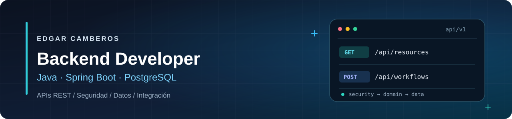

# Edgar Camberos

### Backend Developer · Java & Spring Boot

Desarrollo APIs REST y soluciones backend con especial atención a la seguridad, la persistencia, la trazabilidad y la integración entre servicios. Mi experiencia práctica proviene de **proyectos colaborativos y personales**, desde la implementación hasta el despliegue.

[**Portafolio**](https://cambers.cv) · [**CV en español**](https://cambers.cv/cv/Edgar-Camberos-Backend-Developer-CV-ES.pdf) · [**Resume in English**](https://cambers.cv/cv/Edgar-Camberos-Backend-Developer-Resume-EN.pdf) · [**LinkedIn**](https://www.linkedin.com/in/edgar-camberos-dev/) · [**Correo**](mailto:edgarcamberos18@gmail.com)

📍 Tepic, Nayarit, México · Abierto a oportunidades **Backend Developer**, con prioridad en trabajo remoto para México.

---

## Sobre mí

Me especializo en **Java y Spring Boot**. He trabajado en APIs, autenticación y autorización con JWT, modelado de datos, migraciones, documentación OpenAPI e integración con frontend y servicios Python.

Me interesa construir software mantenible, entender las reglas del negocio y colaborar con equipos que usen revisión de código, pruebas y entregas trazables. También trabajo con React y TypeScript cuando la integración del producto lo requiere.

## Proyectos destacados

### 1. QualityTrack — Gestión industrial y trazabilidad

**Rol:** Backend Developer e integración final · **Contexto:** simulación colaborativa NoCountry, 2026.

Plataforma para gestionar solicitudes, cotizaciones, órdenes de trabajo, producción, inspecciones de calidad, entregas y seguimiento del expediente.

- Implementé flujos de negocio y APIs REST con Spring Boot, PostgreSQL y Flyway.
- Trabajé en reglas de estados, seguridad por roles, inspecciones y trazabilidad entre etapas.
- Participé en la integración final con React y TypeScript para completar el producto.

**Tecnologías:** Java, Spring Boot, Spring Security, PostgreSQL, Flyway, React y TypeScript.

[Demo](https://qualitytrack.cambers.cv) · [Repositorio público](https://github.com/No-Country-simulation/S08-26-Equipo-01) · **PRs de mi autoría:** [cotizaciones #39](https://github.com/No-Country-simulation/S08-26-Equipo-01/pull/39), [calidad #47](https://github.com/No-Country-simulation/S08-26-Equipo-01/pull/47), [trazabilidad #53](https://github.com/No-Country-simulation/S08-26-Equipo-01/pull/53).

### 2. EleVideo — Plataforma de procesamiento de video

**Rol:** Backend Developer · **Contexto:** simulación colaborativa NoCountry, 2026.

Sistema de gestión y transformación de videos para formatos verticales. Mi trabajo se centró en el backend Java y su comunicación con el servicio de procesamiento.

- Organicé responsabilidades del backend con Spring Modulith y desarrollé APIs protegidas con JWT.
- Integré un servicio Python/FastAPI que utiliza MediaPipe y FFmpeg, con seguimiento de trabajos y comunicación mediante webhooks.
- Trabajé en la gestión de proyectos, videos, estados de procesamiento y notificaciones.

**Tecnologías:** Java, Spring Boot, Spring Modulith, PostgreSQL, Python, FastAPI y FFmpeg.

[Demo](https://elevideo.cambers.cv) · [Repositorio público](https://github.com/EdgarCamberos1894/elevideo)

### 3. INCACORE — Mantenimiento y gestión de flotas

**Rol:** Java Backend Developer · **Contexto:** proyecto colaborativo Foo Talent Group, 2025.

Sistema de gestión de flotas, mantenimiento e inventarios.

- Desarrollé APIs para los módulos operativos, incluyendo búsquedas, filtros y paginación.
- Trabajé en autenticación, permisos, tareas programadas y notificaciones por correo.
- Participé en la integración y configuración del despliegue con Docker, PostgreSQL y OpenAPI.

**Tecnologías:** Java, Spring Boot, Spring Security, PostgreSQL, Docker y OpenAPI.

[Demo](https://incacore.cambers.cv) · [Repositorio público](https://github.com/EdgarCamberos1894/Incacore)

### Otros proyectos

| Proyecto | Qué desarrollé | Enlaces |
| --- | --- | --- |
| **ECOS** | APIs de perfiles musicales y canciones, persistencia, seguridad e integraciones multimedia. | [Demo](https://ecos.cambers.cv) · [Código](https://github.com/EdgarCamberos1894/Ecos) |
| **Rentify** | Configuración backend, migraciones y flujos de verificación y recuperación de cuentas. | [Demo](https://rentify.cambers.cv) · [Código](https://github.com/EdgarCamberos1894/Rentify) |
| **ReTrueque** | Modelado de intercambios, reglas de estados, consultas e integración con almacenamiento de imágenes. | [Demo](https://retrueque.cambers.cv) · [Código](https://github.com/EdgarCamberos1894/ReTrueque) |

## Tecnologías y prácticas

| Área | Experiencia práctica |
| --- | --- |
| **Backend principal** | Java 17, Spring Boot, Spring Security, JWT/RBAC, Spring Data JPA, Hibernate, APIs REST |
| **Datos y contratos** | PostgreSQL, MySQL, Flyway, OpenAPI/Swagger, validaciones y modelado relacional |
| **Pruebas y entrega** | JUnit, Mockito, Maven, Docker, Git/GitHub, pull requests y despliegues en Render/Vercel |
| **Integraciones** | Python/FastAPI, FFmpeg, MediaPipe, Cloudinary, Resend y AWS S3 |
| **Complementarias** | React, TypeScript y fundamentos de Node.js/Express |

### Evidencia técnica pública

- [Pruebas del backend de QualityTrack](https://github.com/No-Country-simulation/S08-26-Equipo-01/tree/main/backend/src/test): ejemplos de pruebas de autenticación, servicios y reglas de negocio.
- [Flujo de validación de pull requests](https://github.com/No-Country-simulation/S08-26-Equipo-01/blob/main/.github/workflows/validate-pr-flow.yml): control del flujo de ramas de la simulación.
- [Casos de estudio](https://cambers.cv/#projects): arquitectura, decisiones, desafíos, contribuciones y demostraciones de los seis proyectos.

## Formación

- [Oracle Next Education — formación backend](https://app.aluracursos.com/program/certificate/11c5c475-fb6f-4c82-ab39-42f6407998d5).
- Práctica continua en arquitectura de software, pruebas automatizadas e integración de aplicaciones.

---

### ¿Quieres conocer cómo abordé estos proyectos?

En el portafolio encontrarás demostraciones, arquitectura y evidencia concreta de mi trabajo.

[**Explorar mi portafolio →**](https://cambers.cv)

